# Denominator Boat Dashboard

A touchscreen control system for a 25ft Bertram, built entirely by talking to Grok Bot. Single HTML file, no build step, runs in any browser.

## What it does

- 3D model of the actual boat
- Switches for lights, power, and the 240V inverter
- Lifts for the hardtop, hatches, and engine box
- Trim tabs and bow thruster controls
- Live Scarborough QLD weather and tides
- Wake and spray that respond to the throttle
- Startup screen with a "Shields up" voice line

## Hardware target

Raspberry Pi 5 with a touchscreen, mounted on the helm. Relays, GPS, sensors, and an anchor-locker camera are next.

## Status

About 20 versions in. GUI 19 is the current file in this repo.

## Video

Latest build video (Blob 111): https://www.youtube.com/watch?v=7z-EOGvFbLE

Channel: https://www.youtube.com/@Micington

## Why this repo exists

Most open-source marine Pi dashboards (d3kOS, boatcontrol, BoatBuddy) are Signal K / OpenCPN based. This one was grown conversationally with an AI assistant, no traditional developer in the loop. Whether that's a feature or a bug is up to you.

## Screenshots

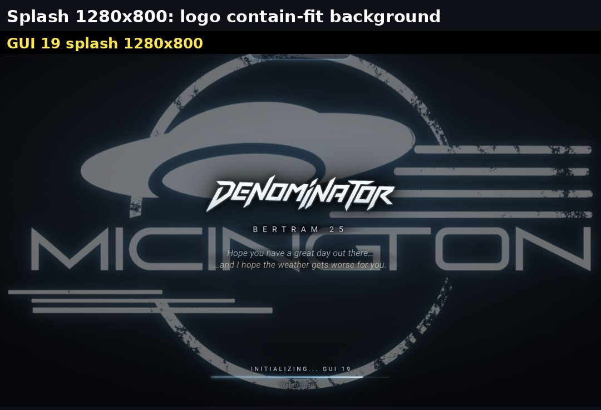

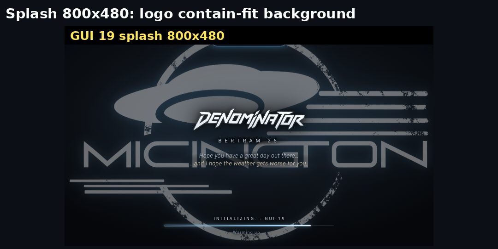

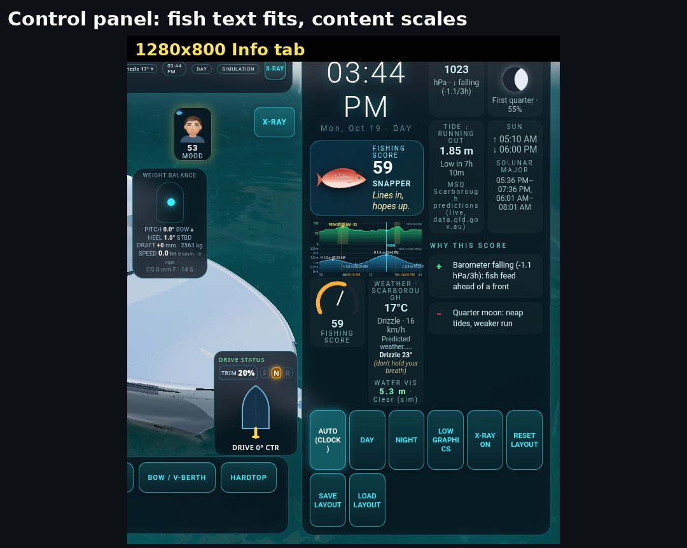

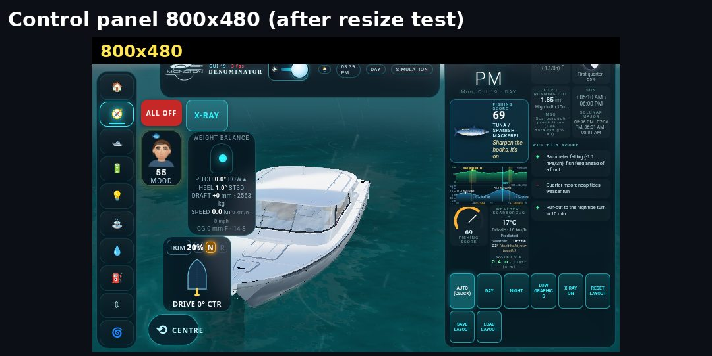

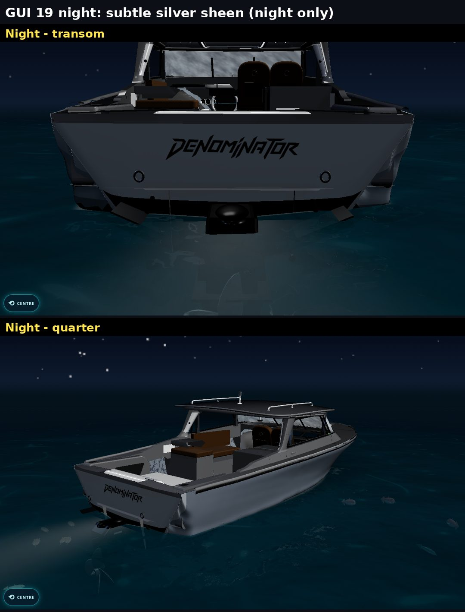

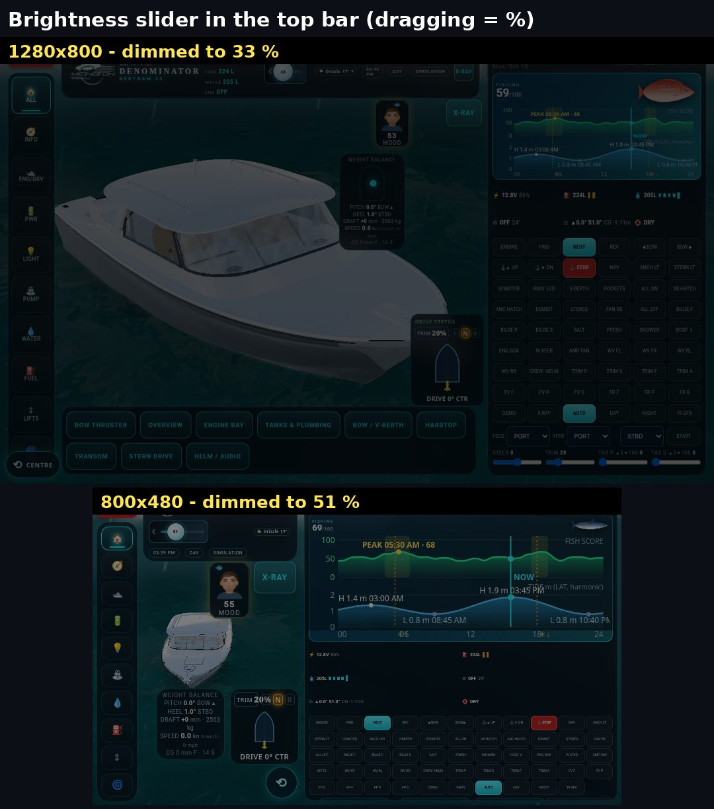

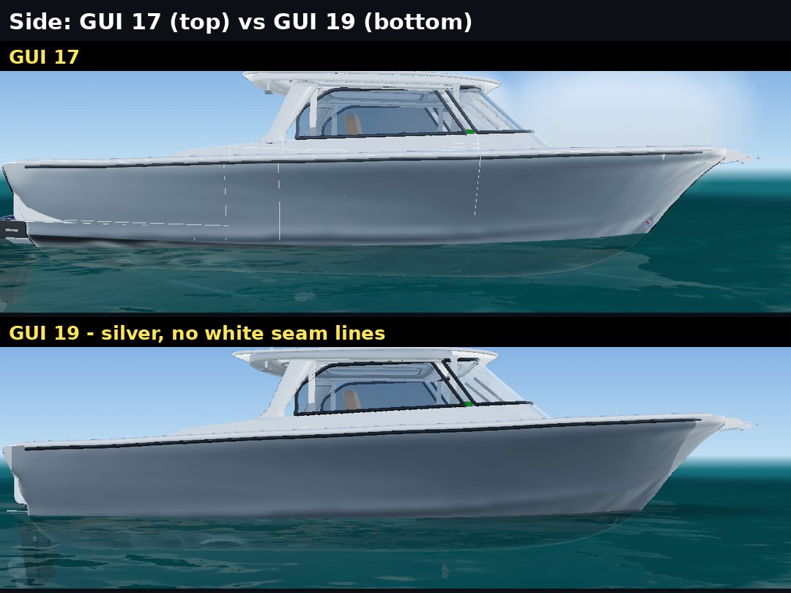

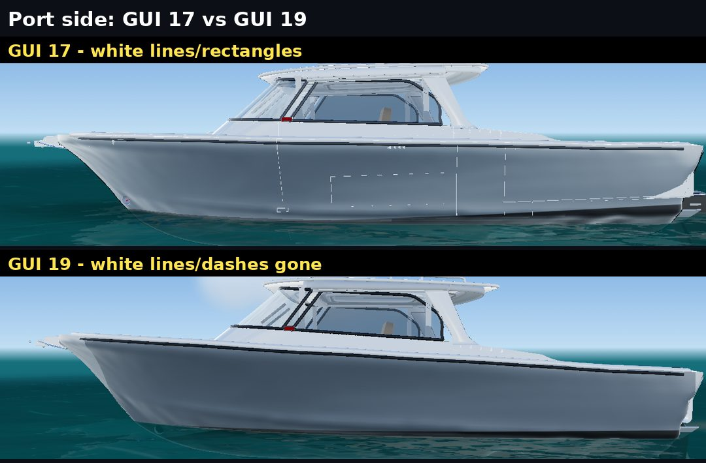

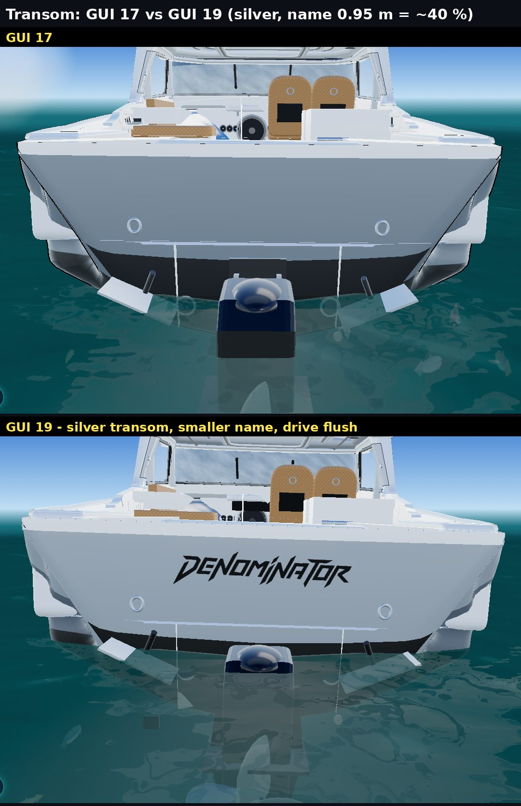

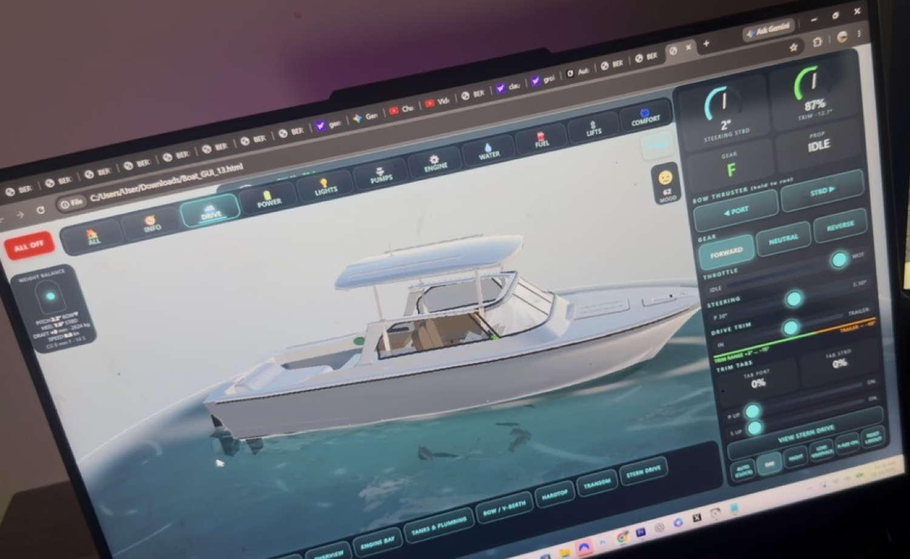

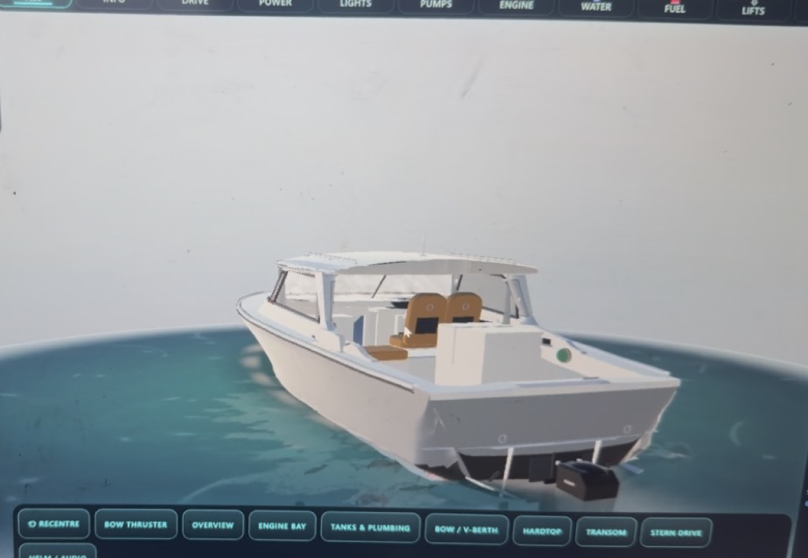
